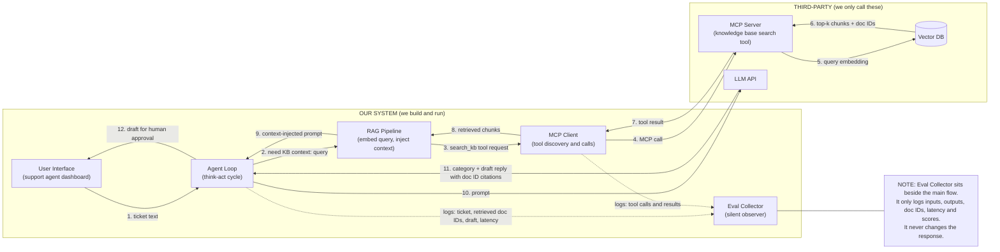

# Architecture Diagram: Support Ticket Assistant

**Use case:** An assistant that classifies customer support tickets and drafts replies grounded in the company knowledge base. A human reviews and sends every reply.

## Request trace (finger test)

User submits a ticket (1) → Agent decides it needs knowledge base context (2) → RAG pipeline builds the query (3) → MCP Client calls the MCP Server (4) → Vector DB search (5-6) → chunks return through MCP (7-8) → RAG injects context into the prompt (9) → Agent sends it to the LLM (10-11) → draft with citations returns to the UI for human approval (12). The Eval Collector logs along the way.

## Pillar choices

I used **RAG** so replies are grounded in real knowledge base documents and cite a document ID for every claim, instead of relying on the LLM's memory. **MCP** connects the agent to the knowledge base through a standard tool protocol, so the data source can be swapped without changing agent code. The **Agent Loop** decides when retrieval is needed, and the **Eval Collector** logs every run so we can measure citation accuracy and draft quality.
